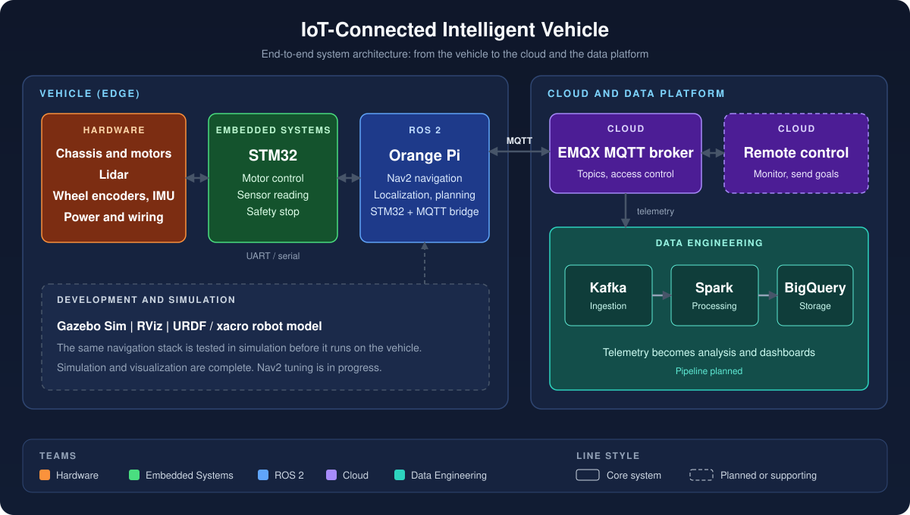

# IoT-Connected Intelligent Vehicle

An autonomous ground vehicle that navigates on its own and streams its data to the cloud for remote monitoring and control.

Graduation project, Faculty of Engineering, Zagazig University (Electronics and Communications Engineering). Supervised by Dr. Azhar.


<p align="center">
  
</p>

## Table of contents

- [Project overview](#project-overview)
- [System architecture](#system-architecture)
- [Roadmap](#roadmap)
- [Repository structure](#repository-structure)
- [Data Engineering](#data-engineering)
- [ROS 2](#ros-2)
- [Embedded Systems](#embedded-systems)
- [Cloud](#cloud)
- [Hardware](#hardware)
- [Contributing](#contributing)

## Project overview

The goal of this project is a vehicle that senses its surroundings, plans a route to a goal and drives itself there, while reporting its state to the cloud in real time. The work is split between five teams. Each team owns one part of the system and documents it in its own section below.

| Team | Responsibility |
| --- | --- |
| [Data Engineering](#data-engineering) | Collecting, processing and storing the data the vehicle produces |
| [ROS 2](#ros-2) | Robot model, simulation and autonomous navigation |
| [Embedded Systems](#embedded-systems) | Firmware on the microcontroller that drives the motors and reads the sensors |
| [Cloud](#cloud) | Connectivity between the vehicle and the cloud, and the cloud services behind it |
| [Hardware](#hardware) | The physical vehicle: chassis, actuators, sensors and power |

## System architecture

The diagram at the top of this page shows the full system.

The microcontroller handles real-time control of the motors and sensors. ROS 2 handles perception and navigation and talks to the microcontroller through a bridge node. Telemetry leaves the vehicle over MQTT, reaches the cloud, and feeds the data pipelines.

## Roadmap

The project is planned in three phases. Software work comes first, so it does not wait for the hardware.

**Phase 1: Simulation and software (no hardware needed)**

- [x] ROS 2 workspace and environment setup
- [x] Robot model (URDF / xacro)
- [x] Gazebo simulation and RViz visualization
- [x] Sending Nav2 goals from Python code
- [x] Map of the simulated world (SLAM) saved for navigation
- [ ] Nav2 parameters tuned to our robot
- [ ] STM32 bridge node
- [ ] MQTT telemetry to EMQX
- [ ] Single package with one launch file

**Phase 2: Decisions before buying hardware**

- [x] Chassis: 4 wheels, skid-steer
- [x] Proximity safety sensor: ToF
- [ ] Lidar model (must have a ROS 2 Jazzy driver)
- [ ] Wheel encoders
- [ ] IMU (optional)

**Phase 3: Hardware**

- [ ] Build the chassis and wire the sensors
- [ ] Set up the onboard computer (Orange Pi) with Ubuntu 24.04 and ROS 2
- [ ] Calibrate odometry
- [ ] Tune Nav2 on the real robot

The Cloud and Data Engineering work (broker, services, pipelines, dashboards) is tracked by those teams in their own sections.

## Repository structure

```text
.
├── docs/            # architecture diagram, demo media
├── ros2/
│   ├── models/      # robot description (URDF / xacro)
│   ├── launch/      # launch files
│   ├── config/      # Nav2 and bridge parameters
│   ├── maps/        # saved maps
│   └── scripts/     # helper scripts (e.g. goal.py)
└── README.md
```

Each team adds its own folder next to `ros2/` when it has files to share.

---

<!-- ===================== DATA ENGINEERING TEAM ===================== -->
<!-- Only the Data Engineering team edits between this marker and the next. -->

## Data Engineering

### Introduction

The Data Engineering team turns the raw data the vehicle produces into something the project can use. It designs the pipelines that ingest telemetry arriving from the cloud, process it, and store it for analysis and visualization.

**Responsibilities**

- Define the data the vehicle produces (sensor readings, pose, status) and its schema
- Build ingestion and processing pipelines
- Store the data and make it available for analysis and dashboards

### Status

The team adds architecture notes, setup steps and results below.


---

<!-- ===================== ROS 2 TEAM ===================== -->
<!-- Only the ROS 2 team edits between this marker and the next. -->

## ROS 2

### Introduction

The ROS 2 team owns the vehicle's software brain: the robot model, the simulation, and the autonomous navigation stack built on Nav2. It also owns the bridge that will connect ROS 2 to the embedded controller and to MQTT.

**Responsibilities**

- Robot description (URDF / xacro)
- Gazebo simulation and RViz visualization
- Mapping, localization and path planning with Nav2
- Integration with the STM32 and MQTT telemetry

### Status

Simulation, visualization, mapping and goal sending are done. Next is tuning Nav2 to our own robot, then the STM32 bridge, MQTT telemetry and final packaging. See the [Roadmap](#roadmap) for the full list.

### Quick start

**Requirements:** ROS 2 **Jazzy** with Nav2 and xacro, Gazebo **Harmonic** with `ros_gz`, and RViz.

From the repository root:

```bash
# 1. View the robot model in RViz
ros2 launch ros2/launch/view_robot.launch.py

# 2. Run our robot in Gazebo (drive it with teleop)
ros2 launch ros2/launch/gazebo_robot.launch.py

# 3. Run Nav2 on the saved map
ros2 launch nav2_bringup tb3_simulation_launch.py headless:=False map:=ros2/maps/my_map.yaml

# 4. Send a goal. The first time, add --init to set the initial pose (once only)
python3 ros2/scripts/goal.py 1.0 0.5 --init
python3 ros2/scripts/goal.py 2.0 1.0
```

Note: step 3 currently runs on the TurtleBot3 demo robot that ships with Nav2, using the map we saved from that simulation. Once Nav2 is tuned to our own robot, this step will use our robot instead.

Code lives in [`ros2/`](ros2/).

---

<!-- ===================== EMBEDDED SYSTEMS TEAM ===================== -->
<!-- Only the Embedded Systems team edits between this marker and the next. -->

## Embedded Systems

### Introduction

The Embedded Systems team owns the firmware that runs on the STM32 microcontroller. It is the real-time layer between the physical vehicle and ROS 2: it drives the motors, reads the sensors and exchanges commands and measurements with the navigation software.

**Responsibilities**

- Motor control and speed regulation
- Reading encoders, IMU and other sensors
- Communication protocol with the ROS 2 bridge node
- Safety behavior, such as stopping on lost communication

### Status

The team adds firmware, pin maps, wiring notes and build instructions below.


---

<!-- ===================== CLOUD TEAM ===================== -->
<!-- Only the Cloud team edits between this marker and the next. -->

## Cloud

### Introduction

The Cloud team owns the link between the vehicle and the internet. It runs the MQTT broker (EMQX), manages the cloud services that receive telemetry, and provides the path for remote monitoring and control.

**Responsibilities**

- MQTT broker setup, topics and access control
- Cloud deployment and services for telemetry
- Secure remote monitoring and control of the vehicle
- Handing data over to the Data Engineering pipelines

### Status

The team adds architecture notes, topic lists and setup steps below.


---

<!-- ===================== HARDWARE TEAM ===================== -->
<!-- Only the Hardware team edits between this marker and the next. -->

## Hardware

### Introduction

The Hardware team owns the physical vehicle. It selects, assembles and wires the chassis, motors, sensors and power system that the other teams build on.

**Responsibilities**

- Chassis and drivetrain
- Sensors: lidar, wheel encoders, IMU and the ToF proximity sensor
- Power supply and wiring
- Mounting of the controller and compute boards

### Status

The chassis type is decided (4 wheels, skid-steer) and so is the ToF proximity sensor. Component selection for the lidar, encoders and IMU is the next planned step. The team adds the parts list, schematics, photos and build notes below.

---

<!-- ===================== TEAM (add at the end of the project) =====================
## Team

| Name | Team | GitHub |
| --- | --- | --- |
|  |  |  |
-->

## Contributing

1. Create a branch: `git checkout -b feature/my-change`
2. Edit only your own team's section of this README and your own team's folders.
3. Commit and push your branch.
4. Open a pull request into `main` and ask a teammate for review.
5. Keep `main` runnable: do not merge broken launch files or models.
